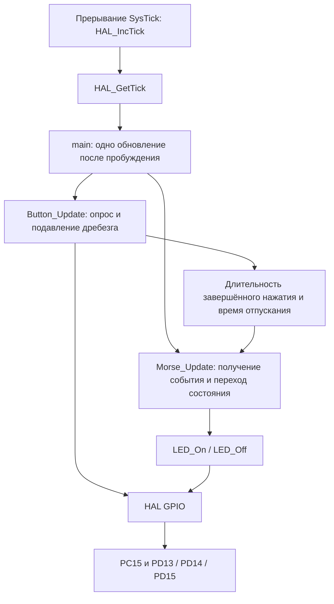
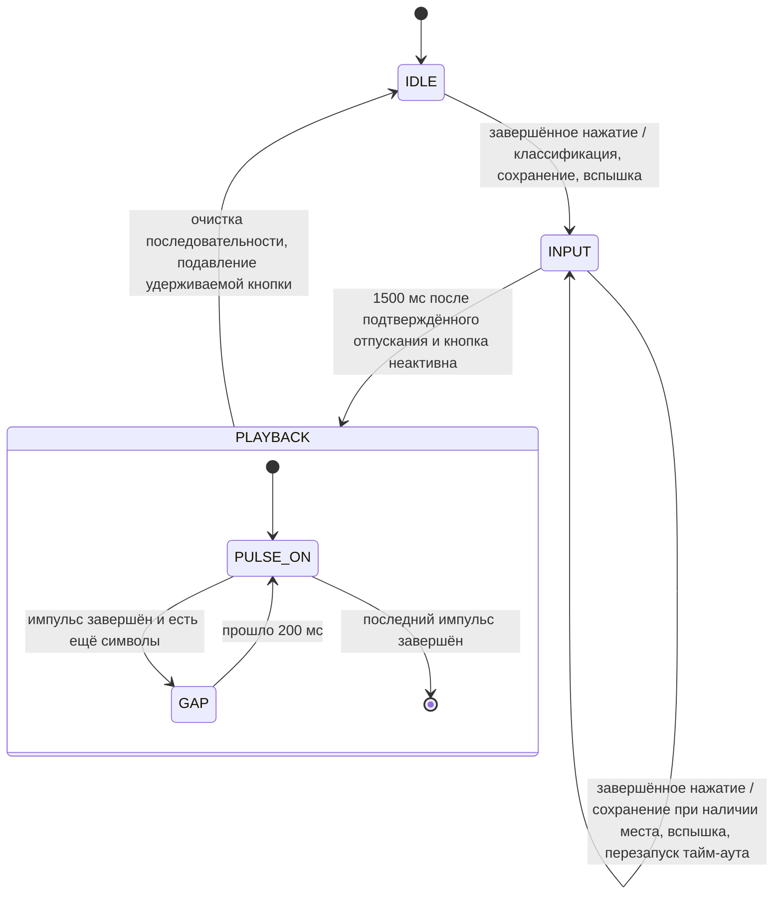

# Архитектура и пояснения для защиты лабораторной

На целевом MCU работает один кооперативный цикл. SysTick отсчитывает миллисекунды;
вся остальная работа выполняется в основном потоке. Приложение не содержит
номеров выводов GPIO.

## GPIO и инициализация

Порт GPIO содержит 16 выводов. Каждый может быть входом, выходом общего назначения,
альтернативной функцией периферии или аналоговым входом. `MODER` выбирает режим.
`OTYPER` выбирает двухтактный выход (push-pull) или открытый сток (open-drain).
`OSPEEDR` управляет скоростью изменения фронтов выхода, а не частотой мигания
приложения. `PUPDR` выбирает слабую внутреннюю подтяжку вверх/вниз или её отсутствие.
`IDR` считывает входной уровень; `ODR` хранит выходную защёлку. `BSRR` устанавливает
или сбрасывает выбранные выходные биты без гонки «чтение–изменение–запись».
`AFRL/AFRH` выбирают альтернативные функции, а `LCKR` может заблокировать настройку
до сброса. См. [RM0090, глава 8](https://www.stmcu.jp/wp/wp-content/uploads/2017/08/RM0090_Rev21.pdf).

Для регистров GPIO нужно тактирование периферии AHB1. `MX_GPIO_Init()` включает
тактирование GPIOC/GPIOD через `__HAL_RCC_GPIOC_CLK_ENABLE()` и аналогичный макрос
для D. Низкий уровень записывается во все три выходные защёлки светодиодов **до**
включения двухтактного режима, чтобы избежать случайного начального цвета.
Низкой скорости выхода достаточно.

PC15 — вход с `GPIO_NOPULL`: на плате есть внешняя подтяжка 3 кОм, кнопка на землю
и RC-цепь. Поэтому низкий входной уровень означает нажатие. Плавающий вход без
этого резистора был бы ненадёжен. PA13/PA14/PA15/PB3/PB4 сохраняют функции JTAG,
заданные после сброса. LSE MCU отключён, поскольку PC15 также имеет функцию
генератора. EXTI не настроен.

`HAL_GPIO_Init()` задаёт режим, тип, скорость и подтяжку. Драйвер кнопки использует
`HAL_GPIO_ReadPin()`. Драйвер светодиодов использует `HAL_GPIO_WritePin()`, который
записывает в BSRR. Отдельный симулятор на компьютере моделирует эти эффекты
регистров; прошивка всегда использует подлинную реализацию ST HAL.

## Тактирование, запуск и время

Для каждого MCU используются собственные таблица векторов запуска ST, макрос
устройства и скрипт компоновщика. После сброса загружается основной указатель
стека, вызывается `SystemInit`, `.data` копируется из flash в RAM, `.bss`
обнуляется, инициализируется среда выполнения C, затем вызывается `main`.
Компоновщик размещает таблицу векторов по адресу `0x08000000`. Обычная SRAM
начинается с `0x20000000`; вершина стека — `0x20020000` для F407 и `0x20030000`
для F427. Область CCM 64 КиБ отдельная и не используется. Резервирование 2 КиБ
под стек не позволяет статическим данным незаметно занять всю RAM; это резерв
компоновщика, а не аппаратная защита стека.

`HAL_Init()` инициализирует HAL/SysTick. `SystemClock_Config()` выбирает внутренний
**HSI 16 МГц** без PLL, делители AHB/APB1/APB2 равны единице. Задержка flash на
этой частоте нулевая. Кварц платы 25 МГц для этой работы не требуется. Точности HSI
достаточно для визуально различимых импульсов человеческого масштаба времени;
эти интервалы не являются прецизионным измерением генератора.

SysTick увеличивает счётчик HAL типа `uint32_t` каждую номинальную миллисекунду.
`HAL_GetTick()` читает его. Прерывания только отсчитывают время и не меняют
состояние кнопки или приложения. После обоих обновлений `__WFI()` усыпляет ядро
до прерывания. Это не активное ожидание GPIO или цикл задержки. Нормальная частота
опроса — примерно один раз в миллисекунду.

Каждый таймер проверяет `(uint32_t)(now - started) >= interval`. Беззнаковое
вычитание работает при переполнении счётчика примерно раз в 49,7 суток. Сравнение
`now` с `started + interval` без обработки переполнения вблизи него дало бы ошибку.
Интервалы должны быть существенно короче полного периода счётчика, а приложение
должно регулярно вызываться; оно не может измерить удержание кнопки в течение
полного 32-битного периода или восстановить переходы, целиком прошедшие между опросами.

## Универсальный драйвер кнопки

Модуль кнопки знает схему с активным низким уровнем и время подавления дребезга,
но ничего не знает о точках, тире, состояниях Морзе или световом подтверждении.

1. Один раз считывает вывод в `Button_Update(now)`.
2. При изменении необработанного уровня сохраняет его и время первого наблюдения.
3. Принимает стабильный переход только после 30 мс неизменного уровня.
4. При принятом нажатии запоминает время исходного перехода.
5. При принятом отпускании вычисляет разность времён исходных переходов и выдаёт
   один `ButtonEvent`. Два периода подавления дребезга не добавляют 30 мс к
   измеренной длительности нажатия. `released_at_ms` — более позднее время
   подтверждённого отпускания для таймера бездействия приложения.
6. `Button_GetEvent()` получает единственное событие однократно. Основной цикл
   вызывает её через `Morse_Update` после каждого обновления кнопки, поэтому очередь не нужна.

Новый дребезг перезапускает таймер стабильного уровня. Краткие отклонения менее
30 мс не становятся нажатиями. RC-цепь платы не заменяет программное подавление
дребезга. `Button_IsActive()` учитывает и предварительное нажатие по необработанному
уровню, и подтверждённое удержание, предотвращая воспроизведение по тайм-ауту
в начале нажатия или при подавлении дребезга отпускания.

`Button_SuppressUntilReleased()` отменяет текущее измерение и ожидающее событие.
После стабильного отпускания обработка возобновляется без ожидания внутри функции.
Удерживаемая при инициализации кнопка подавляется так же. Это универсальная
операция отмены ввода, которую может использовать и другое приложение.

## Универсальный драйвер светодиодов

Приложение обращается к `LED_GREEN`, `LED_RED` и `LED_YELLOW`. Функции драйвера
возвращают управление сразу после записи HAL; таймеров в драйвере нет.

Зелёный светодиод включён при высоком PD13. Красно-жёлтый индикатор включён
встречно-параллельно: жёлтый требует высокого PD14/низкого PD15, красный — низкого
PD14/высокого PD15. Одинаковые уровни выключают индикатор. `LED_On` сначала снимает
сигнал противоположного цвета, затем включает нужный. Выключение неактивного цвета
не нарушает активный. Зелёный управляется независимо. Разбор схемы см. в
[RESEARCH.md](RESEARCH.md).

## Конечный автомат Морзе

`Morse_Update` получает завершённые события даже во время воспроизведения.
Вне воспроизведения длительность `< 400 ms` означает точку, `>= 400 ms` — тире.
Символ добавляется в статический массив ограниченной ёмкости, а жёлтый или красный
вспыхивает на 150 мс. Завершение подтверждения проверяется независимо при каждом
обновлении и не задерживает ввод или воспроизведение. Быстрые последовательные
события заменяют текущее подтверждение последним цветом.

Обновлённое руководство требует до восьми символов; `MORSE_CAPACITY` по умолчанию 8.
После заполнения первые восемь остаются неизменными. Дальнейшие завершённые
нажатия подтверждаются и перезапускают таймер бездействия, но не сохраняются.
Это предотвращает переполнение памяти и запуск воспроизведения, пока пользователь
ещё вводит нажатие. Ёмкость 64 также проверена как переопределение конфигурации.

Через 1500 мс после последнего **подтверждённого отпускания**, только при неактивной
кнопке, состояние однократно меняется на PLAYBACK. Зелёный включается для первого
символа. Точка длится 200 мс, тире — 600 мс. Между символами он выключается на
200 мс. После последнего импульса он выключается и автомат сразу возвращается
в IDLE: завершающая пауза не нужна, поскольку следующего импульса в последовательности нет.

За обновление возможен только один переход сигнала воспроизведения. Каждый
интервал начинается от фактического изменения выхода. Запоздалый опрос может
удлинить импульс/паузу, но не сжимает несколько просроченных переходов в невидимую
вспышку. При обычном опросе раз в 1 мс дискретность планирования составляет
примерно 1 мс плюс время выполнения.

События во время воспроизведения отбрасываются. Нажатие, продолжающееся после его
окончания, подавляется до отпускания и не может внести неполный символ в следующую
последовательность. Новое нажатие после воспроизведения, в том числе на следующем
обновлении, принимается. Динамическое выделение памяти и рекурсия не используются.
Индексы воспроизведения изменяются только в пределах сохранённой длины; после
последнего импульса длина обнуляется.

## Почему задержки запрещены

`HAL_Delay()` на 600 мс или активное ожидание GPIO внутри драйвера помешали бы
вызывающему коду обрабатывать другие события в течение этого интервала. Здесь
каждый вызов опрашивает вход или продвигает состояние и возвращает управление;
временные отметки задают будущие действия. Неизменённый ST HAL содержит определение
`HAL_Delay` и ограниченные проверки готовности при аппаратной инициализации.
Ни приложение во время работы, ни его драйверы не вызывают задержки. Ошибка
инициализации приводит к намеренному фатальному циклу сна для изучения отладчиком;
это не штатная обработка событий.

## Файлы и границы проверки

`main.c` координирует работу; `gpio.c`/`main.h` содержат инициализацию и назначение
выводов платы; `button.c` и `led.c` изолируют ввод/вывод; `morse.c` отвечает за
последовательность, состояния и таймеры; `app_config.h` объединяет все времена
и значения ёмкости. Пользовательские модули вынесены в отдельные файлы, а вызовы
в main находятся в пользовательских областях CubeMX.
См. [меры предосторожности при повторной генерации](BUILD_AND_FLASH.md#редактирование-и-повторная-генерация).

Нативные тесты запускают реальные драйверы и приложение с подменой HAL и явным
заданием времени. Санитайзеры проверяют память и неопределённое поведение на
компьютере. ARM-сборки проверяют заголовки ST, запуск и компоновку. [Модель GPIO](GPIO_SIMULATOR.md)
отдельно проверяет регистровое поведение. Эти проверки не устанавливают работоспособность
USB, питания, точность генератора или фактические цвета на лабораторной плате;
они остаются в [HARDWARE_VALIDATION.md](HARDWARE_VALIDATION.md).
