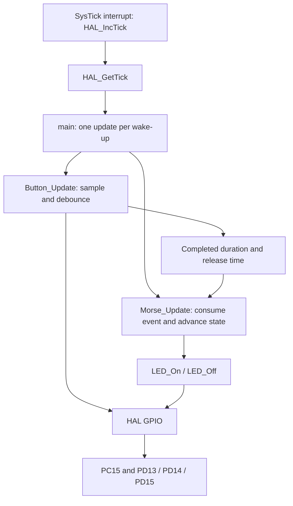
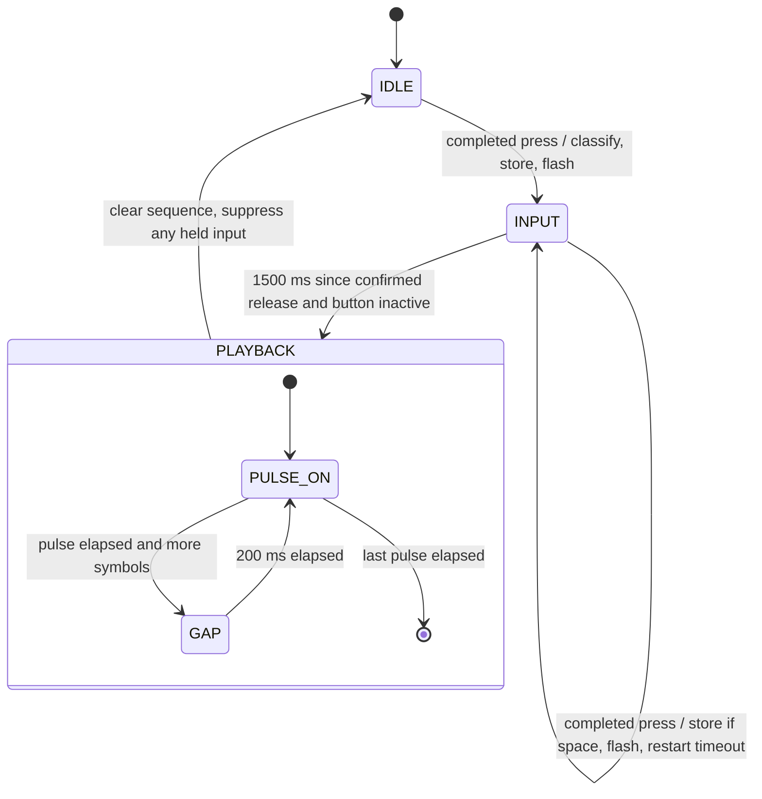

# Architecture and explanation for the laboratory defense

The target runs one cooperative loop. SysTick supplies milliseconds; all other
work happens in the main thread. The application has no GPIO pin numbers.

## GPIO and initialization

A GPIO port contains 16 pins. Each pin can be an input, general-purpose output,
alternate function connected to a peripheral, or analog input. `MODER` selects
the mode. `OTYPER` selects push-pull or open-drain output. `OSPEEDR` controls output
edge slew capability, not the application's blink frequency. `PUPDR` selects a
weak internal pull-up/down or neither. `IDR` reads the input level; `ODR` holds the
output latch. `BSRR` sets or resets selected output bits without a read-modify-write
race. `AFRL/AFRH` select alternate functions, and `LCKR` can lock configuration
until reset. See [RM0090, chapter 8](https://www.stmcu.jp/wp/wp-content/uploads/2017/08/RM0090_Rev21.pdf).

GPIO registers require their AHB1 peripheral clocks. `MX_GPIO_Init()` enables
GPIOC/GPIOD clocks with `__HAL_RCC_GPIOC_CLK_ENABLE()` and its D equivalent.
It writes all three LED output latches low **before** enabling push-pull output
mode, avoiding an unintended initial color. Low output speed is sufficient.

PC15 is an input with `GPIO_NOPULL`: the actual board has an external 3 kohm
pull-up, a switch to ground, and an RC network. Therefore a low input means
pressed. A floating input without that board resistor would be unreliable.
PA13/PA14/PA15/PB3/PB4 keep their reset JTAG functions. MCU LSE is disabled because
PC15 also has an oscillator function. No EXTI is configured.

`HAL_GPIO_Init()` sets mode/type/speed/pull fields. The button driver uses
`HAL_GPIO_ReadPin()`. The LED driver uses `HAL_GPIO_WritePin()`, which writes BSRR.
The separate host simulator models those register effects; firmware always uses
the genuine ST HAL implementation.

## Clock, startup and time

Each MCU has its own ST startup vector table, device macro and linker script.
Reset loads the main stack pointer, calls `SystemInit`, copies `.data` from flash
to RAM, zeroes `.bss`, initializes the C runtime, then enters `main`. The linker
puts the vector at `0x08000000`. Normal SRAM starts at `0x20000000`; the stack top
is `0x20020000` for F407 and `0x20030000` for F427. The 64 KiB CCM region is separate
and unused. A 2 KiB stack reservation ensures static data cannot fill the entire
RAM unnoticed; this is a linker reservation, not a hardware stack guard.

`HAL_Init()` initializes the HAL/SysTick. `SystemClock_Config()` selects the
internal **HSI 16 MHz** with no PLL and AHB/APB1/APB2 dividers of one. Flash latency
is zero at this frequency. The board's 25 MHz crystal is not required by this
exercise. HSI accuracy is adequate for visibly different human-speed pulses;
these timings are not precision oscillator measurements.

SysTick increments the HAL's `uint32_t` tick every nominal millisecond.
`HAL_GetTick()` reads it. Interrupts only advance time; they do not mutate button
or application state. After both updates, `__WFI()` puts the core to sleep until
an interrupt wakes it. This is not active waiting for a GPIO or a delay loop.
Normal sampling is approximately once per millisecond.

Every timer tests `(uint32_t)(now - started) >= interval`. Unsigned subtraction
works across the tick's approximately 49.7-day wrap. Comparing `now` against
`started + interval` without wrap handling would fail near overflow. Intervals
must remain much shorter than a full tick period, and the application must be
serviced regularly; it cannot measure a button held for an entire 32-bit period
or recover button edges that occurred entirely between polls.

## Generic button driver

The button module knows active-low wiring and debounce timing, but nothing about
dots, dashes, Morse states or LED feedback.

1. Sample the pin once in `Button_Update(now)`.
2. On a raw-level change, store that level and its first observation time.
3. Accept a stable transition only after the level stays unchanged for 30 ms.
4. At an accepted press, remember the raw transition's timestamp.
5. At an accepted release, calculate the difference between raw edge timestamps
   and publish one `ButtonEvent`. The two debounce periods do not add 30 ms to
   the measured press duration. `released_at_ms` is the later, confirmed-release
   time used for the application's inactivity timer.
6. `Button_GetEvent()` consumes the single event once. The main loop calls it
   through `Morse_Update` after every button update, so a queue is unnecessary.

A new bounce restarts the stable-level timer. Brief excursions under 30 ms do
not become presses. The board's RC circuit does not replace software debounce.
`Button_IsActive()` includes both a raw candidate press and a debounced held
state, preventing timeout playback during the beginning of a press or its
release debounce.

`Button_SuppressUntilReleased()` cancels an in-progress measurement and pending
event. It rearms after stable release, without waiting inside the function.
A button held during initialization is suppressed in the same way. This is a
generic input-cancellation operation that another application could also use.

## Generic LED driver

The application addresses `LED_GREEN`, `LED_RED` and `LED_YELLOW`. The driver's
functions return immediately after HAL writes; there are no timers in the driver.

The green LED is on when PD13 is high. The red/yellow device is antiparallel:
yellow requires PD14 high/PD15 low; red requires PD14 low/PD15 high. Driving both
ends equally turns it off. `LED_On` first removes the other color's drive and
then applies the requested one. Turning off an inactive color does not disturb
the active color. Green can be controlled independently. See the schematic
analysis in [RESEARCH.md](RESEARCH.md).

## Morse finite-state machine

`Morse_Update` consumes completed events even during playback. Outside playback,
duration `< 400 ms` becomes dot; `>= 400 ms` becomes dash. It appends the symbol to
a static bounded array and flashes yellow or red for 150 ms. Feedback expiration
is checked independently every update, so it does not delay input or playback.
Fast consecutive events replace the current feedback with the latest color.

The updated manual requires up to eight symbols; `MORSE_CAPACITY` defaults to 8.
When full, the first eight remain unchanged. Further completed presses receive
feedback and restart the inactivity timer, but are not stored. This avoids memory
overflow and avoids starting playback while the user is still entering a press.
Capacity 64 is also tested as a configuration override.

After 1500 ms from the last **confirmed release**, and only with no active
button, the state changes once to PLAYBACK. The green LED turns on for the first
symbol. A dot lasts 200 ms; a dash 600 ms. Between symbols it turns off for
200 ms. The final pulse turns off and immediately returns to IDLE: a trailing
gap is unnecessary because there is no next pulse in that sequence.

Only one playback edge can occur in an update. Each interval starts at the
actual output transition. A late poll may lengthen a pulse/gap; it cannot
collapse several overdue edges into an invisible burst. With the normal 1 ms
poll cadence, scheduling quantization is approximately 1 ms plus execution time.

Events during playback are discarded. A press still held when playback finishes
is suppressed until released; it cannot enter a partial symbol into the next
sequence. A fresh press after playback, including at the very next update, is
accepted. No dynamic allocation or recursion is used. Playback indexes advance
only within the stored length; that length clears after the last pulse.

## Why delays are forbidden

A 600 ms `HAL_Delay()` or GPIO busy-wait inside a driver would prevent the caller
from processing other events during that interval. Here each call samples or
advances state and returns; timestamps represent future work. ST's unmodified
HAL includes a `HAL_Delay` definition and bounded readiness checks used during
hardware initialization. Neither the application's runtime nor its drivers
call a delay. An initialization failure enters a deliberate fatal sleep loop
for debugger inspection; it is not normal event processing.

## Files and verification boundary

`main.c` coordinates; `gpio.c`/`main.h` contain board initialization/mapping;
`button.c` and `led.c` isolate input/output; `morse.c` owns sequence/state/timers;
`app_config.h` centralizes all application timing and capacity values.
Custom modules are separate files, and calls in main use CubeMX user regions.
See [regeneration precautions](BUILD_AND_FLASH.md#editing-and-regeneration).

Native tests execute the actual drivers and application with a fake HAL boundary
and explicit time. Sanitizers check host memory/undefined behavior. ARM builds
validate the ST headers, startup and linkers. The [GPIO model](GPIO_SIMULATOR.md)
checks register-level behavior separately. These checks cannot establish USB,
power, oscillator accuracy or observed LED colors on the actual laboratory board;
those remain in [HARDWARE_VALIDATION.md](HARDWARE_VALIDATION.md).
